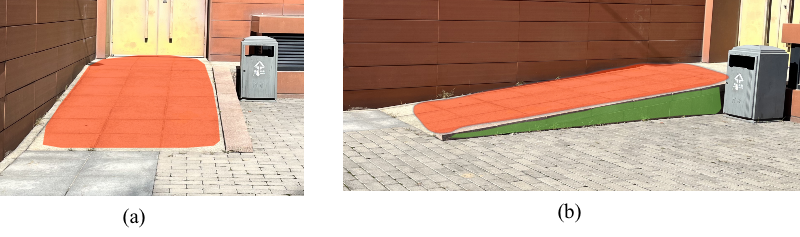
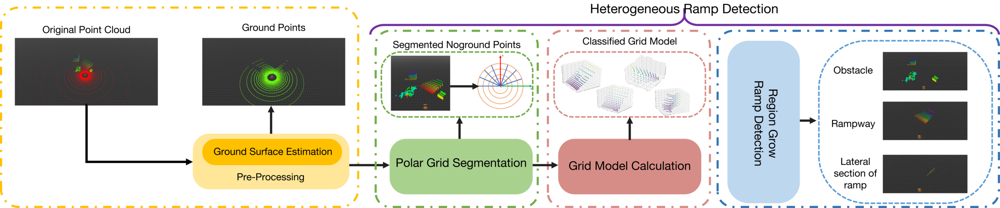
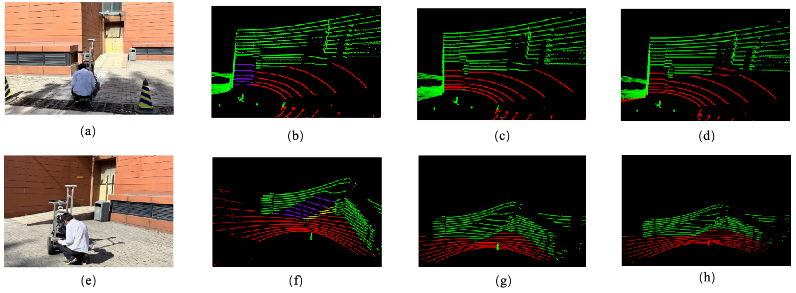
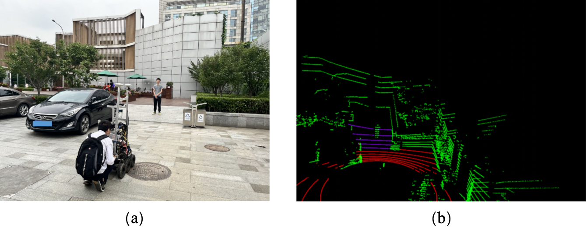
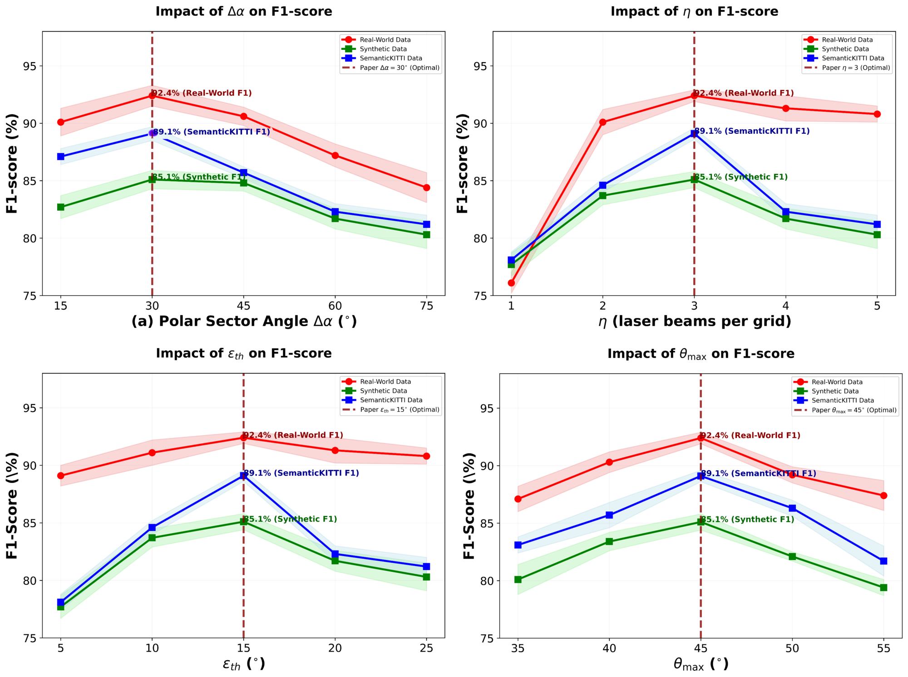

# RG-Seg

Official companion repository and reproducibility record for **RG-Seg: A 3D LiDAR-Based Method for Heterogeneous Ramp-Aware Ground Segmentation**.

  

<em>Heterogeneous ramp observations considered by RG-Seg: a forward-facing ramp (left) and a semi-observed ramp (right).</em>

## Overview

RG-Seg is a deterministic, non-learning method for ramp-aware ground segmentation from 3D LiDAR point clouds. It combines an existing ground-segmentation backbone with a plug-and-play Heterogeneous Ramp Detection (HRD) module designed to handle both forward-facing and semi-observed ramps.

The HRD module uses polar-grid partitioning, grid-level geometric model discrimination, and eight-neighborhood region growing to identify connected ramp structures. Non-planar residuals are preserved as potential obstacle candidates rather than being merged into the ramp surface.

  

<em>RG-Seg pipeline: ground-surface estimation followed by polar-grid segmentation, grid-model calculation, and region-growing ramp detection.</em>

## Repository Status

The RG-Seg source code and evaluation scripts will be released in this repository. The public release will include:

- the C++ implementation of RG-Seg and the HRD module;
- ROS Melodic and PCL build instructions;
- fixed configuration files used for the reported experiments;
- scripts for the real-world, synthetic, and SemanticKITTI evaluations;
- the common point-level Precision, Recall, and F1 evaluation code;
- provenance records for all compared baselines; and
- patches or reimplementation notes needed to reproduce the baseline results.

## Qualitative Results

The following examples illustrate the method on forward-facing and semi-observed ramps. In the point-cloud visualizations, the colors follow the manuscript convention for segmented ground, ramp, and residual structures.

  

<em>Real-world comparison. From left to right within each row: environment, RG-Seg, R-GPF, and LR-Seg.</em>

  

<em>Qualitative example of non-planar residual preservation: RG-Seg separates the ramp surface from potential obstacle-candidate points.</em>

## Evaluation Sources

The paper evaluates one fixed RG-Seg parameter configuration on three data sources:

- 600 annotated scans sampled from 30 real-world ramp scenes;
- 3,000 synthetic scans generated with HDL-16, HDL-32, and HDL-64 sensor models; and
- 200 ramp-containing scans selected from SemanticKITTI.

The reported parameter configuration is:

| Parameter | Value |
|---|---:|
| Polar sector angle, `Delta alpha` | 30 deg |
| Laser beams per grid, `eta` | 3 |
| Region-growing threshold, `epsilon_th` | 15 deg |
| Ramp cutoff angle, `theta_max` | 45 deg |

The same resulting configuration is used across the three data sources; it is not retuned separately for an individual dataset. As stated in the paper, the evaluation data contributed to parameter selection, so the results are not presented as an independent cross-dataset generalization test.

  

<em>Ramp-segmentation F1 sensitivity to the four principal parameters. Dashed lines mark the selected tested values.</em>

## Baseline Reproducibility

The following records identify the implementations and configurations used to generate the baseline results in the paper.

| Method | Implementation used | Version anchor | Configuration source |
|---|---|---|---|
| R-GPF | [URL-KAIST Ground-Segmentation-Benchmark](https://github.com/url-kaist/Ground-Segmentation-Benchmark) | [`af253df`](https://github.com/url-kaist/Ground-Segmentation-Benchmark/commit/af253dfad8d84668137a59295e41599a26558704) | [`config/params.yaml`](https://github.com/url-kaist/Ground-Segmentation-Benchmark/blob/af253dfad8d84668137a59295e41599a26558704/config/params.yaml), `r_gpf` section |
| CascadedSeg | [URL-KAIST Ground-Segmentation-Benchmark](https://github.com/url-kaist/Ground-Segmentation-Benchmark), based on the [authors' implementation](https://github.com/n-patiphon/cascaded_ground_seg) | [`af253df`](https://github.com/url-kaist/Ground-Segmentation-Benchmark/commit/af253dfad8d84668137a59295e41599a26558704) | [`config/params.yaml`](https://github.com/url-kaist/Ground-Segmentation-Benchmark/blob/af253dfad8d84668137a59295e41599a26558704/config/params.yaml), `cascaded_gseg` section |
| PatchWork | [URL-KAIST Ground-Segmentation-Benchmark](https://github.com/url-kaist/Ground-Segmentation-Benchmark), the paper-version comparison code recommended by the [PatchWork repository](https://github.com/LimHyungTae/patchwork) | [`af253df`](https://github.com/url-kaist/Ground-Segmentation-Benchmark/commit/af253dfad8d84668137a59295e41599a26558704) | [`config/params.yaml`](https://github.com/url-kaist/Ground-Segmentation-Benchmark/blob/af253dfad8d84668137a59295e41599a26558704/config/params.yaml), `patchwork` section |
| PatchWork++ | [URL-KAIST PatchWork++ ROS1](https://github.com/url-kaist/patchwork-plusplus-ros) | [`6f9b081`](https://github.com/url-kaist/patchwork-plusplus-ros/commit/6f9b081d68d0c9eddda74d2763de1d3f8e51ac04) | [`config/params.yaml`](https://github.com/url-kaist/patchwork-plusplus-ros/blob/6f9b081d68d0c9eddda74d2763de1d3f8e51ac04/config/params.yaml) |
| LR-Seg | Authors' original C++ implementation corresponding to the LR-Seg paper | Author-provided experimental snapshot; no public tag | Parameter set reported in the LR-Seg paper |

The main fixed settings are summarized below.

- **R-GPF:** 3 fitting iterations, 10 LPR points, 9-point minimum, seed/distance thresholds of 0.4/0.12 m, 32 rings, 108 sectors, and an 80 m maximum range.
- **CascadedSeg:** 5 deg maximum slope, 0.50 m vertical threshold, 0.08 m plane-distance threshold, 4 sections, and plane-height/angle thresholds of 5.0 m/16 deg.
- **PatchWork:** 3 iterations, 20 LPR points, 10-point minimum, seed/distance thresholds of 0.5/0.125 m, a 2.7-80 m range, uprightness threshold 0.707, CZM sector counts `[16, 32, 54, 32]`, and ring counts `[2, 4, 4, 4]`.
- **PatchWork++:** 3 iterations, 20 LPR points, 10-point minimum, ground seed/distance thresholds of 0.3/0.125 m, vertical seed/distance thresholds of 0.25/0.10 m, a 2.7-80 m range, uprightness threshold 0.707, with RNR, R-VPF, and TGR enabled.
- **LR-Seg:** ring counts `[4, 2]`, sector counts `[32, 16]`, a 0.5-50 m range, `z_lpr=10`, `z_seed=0.45`, `tau=0.3`, `theta_uprightness=0.866`, and `beta_angle=0.9`.

Only point-type and data-I/O adapters were added, together with the LiDAR mounting height and beam count supplied as sensor metadata. No baseline algorithmic stage or decision threshold was changed. One algorithmic configuration per method was used for all three data sources; no baseline was retuned for an individual data source.

## Software Environment

- Ubuntu 18.04 LTS
- ROS Melodic
- Point Cloud Library (PCL)
- C++

Exact dependency versions and build commands will be included with the source release.

## Citation

The final bibliographic entry will be added after publication.

## License

A source-code license will be added with the public code release after the third-party baseline licenses have been checked.
